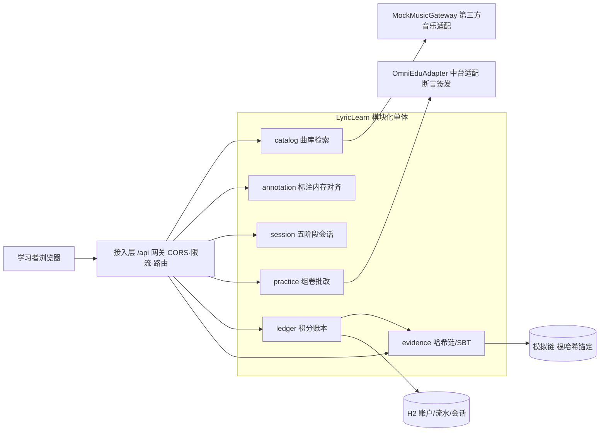
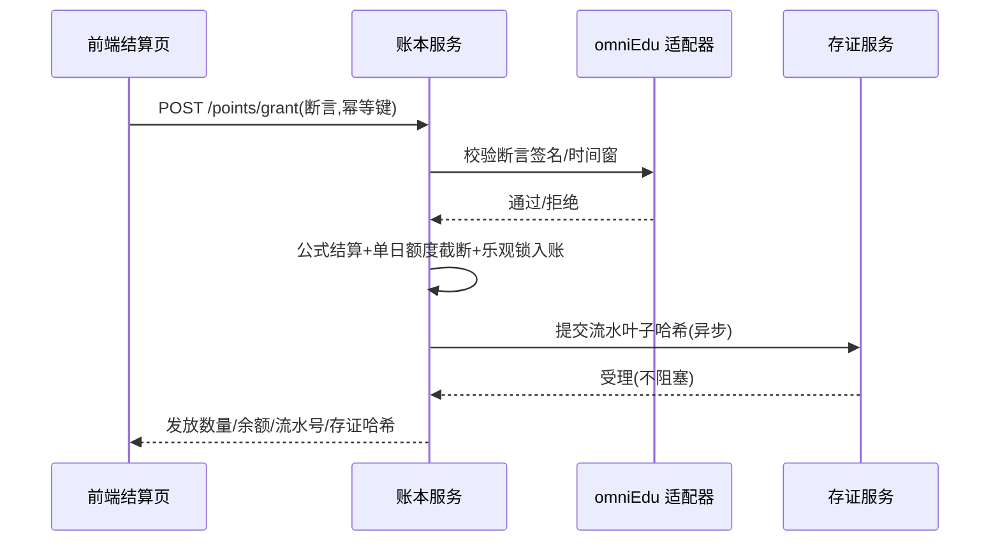
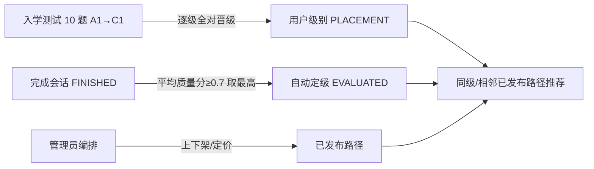

# LyricLearn 英文歌曲学习平台

> 依据《LyricLearn 产品需求文档 PRD V1.3》与《技术架构设计文档 V1.0》实现的**第一阶段可运行 MVP**（模块化单体）。
> 以英文歌曲为素材，提供逐词音标 / 逐句释义 / 刻意练习闭环 / 封闭学习积分（LearnPoint）/ 链上存证与不可转让 SBT 凭证的完整演示链路。

## 一、已实现能力（对照 PRD / 架构文档）

### 总体分层架构



### 积分发放链路（PRD 7.5 / 架构 12.1）



| 领域 | 已落地 | 对应文档 |
| --- | --- | --- |
| 曲库检索 | 第三方网关抽象、元信息检索、可学习标记、降级为仅跳转收听 | PRD 第5章 / 架构 5.4、6.1 |
| 学习主链路 | 五阶段状态机（预习→精听→跟读→练习→复习结算）、刻意/休闲双模式 | PRD 4.3、4.5 |
| 歌词与标注 | 歌词仅请求内存对齐下发，**不落库、不缓存、不导出**；生词/音标/释义解析包 | PRD 3.3、13.4 合规约束 |
| 练习编排 | 四类题型动态组卷、作答批改、质量评分、中台学习断言签发与签名校验 | PRD 6.2、6.4 / 架构 7 |
| 积分发放 | 公式结算 `基础×CEFR×质量×重复衰减`、断言前置校验、单日额度硬截断、乐观锁、幂等键 | PRD 7.2、7.5 / 架构 9 |
| 积分兑换 | 余额校验、扣减与权益发放同事务、幂等、人民币直购并列通道 | PRD 7.3、7.6 |
| 积分账本 | 用户侧分录、流水号、余额、累计、分页账本、单笔摘要哈希 | 架构 9.1 |
| 存证与 SBT | 单笔 SHA-256、窗口哈希链批量锚定（内存模拟链）、不可转让凭证铸造、重复铸造拦截 | PRD 7.7 / 架构 10 |
| 英文文章学习 | 自建文章库（原创科普/生活短文 + 公有领域名人演讲稿），难度与歌曲同 CEFR 分级，阅读→生词→小测→结算发积分全链路复用歌曲会话/批改/账本 | 本次新增 |
| 页面 | 歌曲列表、学习页、文章列表/阅读页、积分中心、兑换商城、学习结算页（深色青绿主题） | PRD 第8章 |

### 积分公式（已按 PRD 表8 实现）

```
本次积分 = 基础奖励(10) × CEFR系数 × 质量系数 × 重复衰减系数
CEFR:  A1 0.6 / A2 0.8 / B1 1.0 / B2 1.3 / C1+ 1.6
质量:  <0.4→0；[0.4,0.7)→0.5；[0.7,0.9)→1.0；≥0.9→1.2
重复:  首次 1.0；重复复习 0.3
```

### 英文文章学习模块（与歌曲同级难度）

文章模块与歌曲学习共用同一套会话、组卷、批改、断言、积分账本与结算页，仅素材源不同。

**难度分级与歌曲一致（CEFR / L 级）**：A1/L0、A2/L1、B1/L2、B2/L3、C1/L4，文章卡片显示 CEFR 标签，列表可按级别、分类（英文新闻 NEWS / 名人演讲稿 SPEECH / 诗歌 POEM；小说 NOVEL 预留）、关键词筛选。

**自建文章库（当前种子：原创短文 + 公有领域诗歌/演说，`ArticleSeeder`）**：

| articleId | 标题 | 级别 | 分类 | 来源属性 |
| --- | --- | --- | --- | --- |
| art-bee | The Bee and the Flower | A2 | NEWS | 平台原创科普短文 |
| art-city | Walking in the City | B1 | NEWS | 平台原创生活短文 |
| art-getty | The Gettysburg Address (Excerpt) | B1 | SPEECH | 林肯 1863 年葛底斯堡演说，**公有领域**节选 |
| art-dream | Hold on to Your Dream | B2 | SPEECH | 平台原创励志演讲 |
| art-ted | TED Talk: Ideas Worth Spreading (Demo) | B1 | SPEECH | **摘要+外链**示范：平台导读，原文跳转 TED 官方页 |
| art-poem-diddle | Hey Diddle Diddle | A1/L0 | POEM | 公有领域传统童谣 |
| art-poem-sheep | Little Bo-Peep | A2/L1 | POEM | 公有领域传统童谣 |
| art-poem-lamb | The Lamb | B1/L2 | POEM | 布莱克 1789《天真之歌》，**公有领域** |
| art-poem-tyger | The Tyger | B2/L3 | POEM | 布莱克 1794《经验之歌》，**公有领域** |
| art-poem-sonnet | Sonnet 18 (Excerpt) | C1/L4 | POEM | 莎士比亚十四行诗，**公有领域**节选 |

**两种呈现模式（`accessMode`）**：

- `FULL_TEXT` 站内全文：平台原创 / 公有领域作品（art-bee、art-city、art-getty、art-dream），服务端下发分段正文。
- `SUMMARY_LINK` 摘要+外链：受版权保护的第三方新闻/演讲，**服务端不下发原文段落**，仅返回平台撰写的中文导读摘要、核心生词与 `sourceUrl`；前端展示导读卡片 + "阅读原文（新标签页跳转）"外链按钮（`target=_blank rel=noopener`），列表卡片带"摘要+外链"标记。

**学习链路（复用歌曲，零改动）**：`POST /sessions`（`platform:'article'`、`songId=articleId`）→ `GET /practice/{sessionId}/quiz` 组卷（填空/词匹配单选 + 仿写 textarea；SUMMARY_LINK 仅基于导读与生词命题，不依赖原文）→ `POST /practice/{sessionId}/submit` 批改出质量分与断言 → 结算页读 `lastGrade` → `POST /points/grant` 按同一公式发积分。已实测：art-bee 答对 4/4 发放 10 积分（10×A2 0.8×质量1.2×首次1.0）；art-ted（SUMMARY_LINK）答对 4/4 发放 12 积分（10×B1 1.0×质量1.2×首次1.0）。

**学习路径（L0–L4 线性解锁，`/path` 页面）**：

- 关卡按 `level`（L0–L4）分组，**一级全部篇目质量分达标（≥0.7）后解锁下一级**；达标成绩取自已完成会话（FINISHED）的最高质量分，无需额外存储。
- 篇目三态：`done`（已达标）/ `available`（本级可学）/ `locked`（未解锁置灰）；仅 `available` 可点击进入阅读。
- 接口 `GET /api/path?userId=` 返回各级 `unlocked / allPassed / items[{articleId,bestScore,status}]`。
- 诗歌题型含 `ORAL_RECALL` 跟读复述（勾选"我已跟读并复述这句"即得分），阅读页诗句分行展示。

**文章是否提供下载（产品评估结论，已落地为摘要+外链）**：

- **原文不提供整文下载 / 导出 / 复制打包**。理由与"歌词不落库"一致：新闻原文受版权保护，不做全文抓取、转载或批量导出；受版权保护的现代名人演讲稿也不贴全文。
- **采用"摘要 + 外链跳转"方案**：受版权素材只在站内呈现平台导读摘要，原文通过外链跳到第三方官方页面阅读，本站不存储、不转载原文。
- **可导出的仅限学习者自己的增强产物**：个人生词表、学习档案 PDF（对应商城已有权益"学习档案 PDF 导出 120 积分"）。这是用户自己的学习数据，不含第三方原文，不构成版权问题。
- **名人演讲稿**：公有领域作品（如葛底斯堡演说）可站内全文；版权现代演讲走摘要+外链。
- **英文新闻同步**：当前为内置原创/公有领域种子，不做 RSS 全文同步；未来接入真实新闻采用"摘要 + 原文外链"，不复制受保护正文。

## 一·五、用户、资料中心与混合学习路径（P0）

**用户（P0 mock，无注册登录）**：内置学员/管理员账号（u-demo 学员 A2、u-lily 学员 B1、u-admin 管理员），顶部下拉切换身份，切换后按新 userId 拉取账户；角色标签 STUDENT/ADMIN，本期不做密码与权限后台。

**学习资料中心（`/library`）**：统一聚合歌曲、英文新闻、名人演讲稿、公有领域诗歌，按类型（歌曲/新闻/演讲稿/诗歌）与 CEFR 级别筛选、关键词搜索；卡片点击分别进入歌曲刻意学习页或文章阅读页。

**预置混合学习路径（`/paths`，`/api/learning-paths`）**：歌曲 + 文章/诗歌自由组合的成套路径，标学分供学员挑选，点击"开始学习"进入路径首个资源：

| pathId | 路径 | 级别 | 学分 | 组合 |
| --- | --- | --- | --- | --- |
| lp-first-steps | 启蒙入门包（歌曲+童谣） | A1/L0 | 50 | twinkle 歌曲 + 两首童谣诗歌 |
| lp-news-speech | 新闻与演说进阶包 | B1/L2 | 90 | 新闻短文 + 葛底斯堡演说 + Let It Be |
| lp-literary | 文学抒情提升包 | B2/L3 | 120 | 励志短文 + The Tyger + Yesterday |

**学分定位（沿用现有 LearnPoint）**：学习考核达标即赚学分（复用现有发放链路与公式）；资源/路径标学分作为兑换门槛，沿用现有商城兑换。**购买学分本期仅占位、不接真实支付**，保持"无现金价值、不可充值"口径；真实支付、管理员编排后台、入学定级测试列二期。

## 一·六、二期：mock 充值、管理员编排、自动定级与推荐

### 1. 学分购买 mock 收银台（不接真实支付）

积分中心新增 mock 充值档位卡片与确认弹窗，仅演示"购买到账"流程，**不发生真实扣款、无现金价值、不构成兑付**。

- `GET /api/points/packages` 返回三档：pkg-100（100 学分/10 元 mock）、pkg-300（300 学分/28 元 mock）、pkg-600（600 学分/52 元 mock）。
- `POST /api/points/top-up`（`{userId, packageId, idempotentKey}`）：按档位 CREDIT 入账，`bizType=TOPUP`，幂等键去重；**不受学习单日上限约束**，返回到账数量、余额、流水号与存证哈希。
- 账本新增"演示充值"分录；余额、累计获得即时刷新。

### 2. 管理员编排后台（路径 CRUD / 定价 / 上下架）

仅 ADMIN 在导航看到"管理后台"入口（`/admin`），学员不显示。

- `GET /api/admin/paths`：全部路径（含已下架）；`POST /api/admin/paths` 新建；`PUT /api/admin/paths/{pathId}` 改标题/描述/级别/学分定价/排序/上下架/资源组合；`DELETE /api/admin/paths/{pathId}` 删除。
- `GET /api/admin/paths/resources`：聚合歌曲 + 文章（新闻/演讲稿/诗歌）作为可选资源枚举，管理员勾选组合成混合路径。
- 表格展示标题、级别、学分价、资源数、上下架状态；上下架开关即时切换，**学员侧 `/api/learning-paths` 仅返回已发布路径**。
- 路径主表 `learning_path` 与明细表 `learning_path_item`（type=SONG/ARTICLE、ref、title、cefr、seq）持久化；启动空表时写入原三条预置路径。

### 3. 自动定级 + 入学分级测试 + 按级别推荐

**入学测试（`/placement`）**：A1→C1 逐级考核，每级 2 道单选共 10 题，`GET /api/placement/quiz` 发题，`POST /api/placement/submit`（`{userId, answers}`）逐级判分：某级 2 题全部答对即晋级到该级，一旦未全对则停止晋级，定级到连续全对到达的最高级别，结果写入用户级别（source=PLACEMENT）。

**按成绩自动定级**：`GET /api/level/evaluate?userId=` 统计该用户 FINISHED 会话，按 CEFR 分组取平均质量分，≥0.7 的最高达标级别即为新级别（source=EVALUATED），无达标记录则沿用当前级别；`GET /api/level/status?userId=` 返回当前级别。

**按级别推荐**：`GET /api/paths/recommend?userId=` 依据当前级别返回**同级或相邻一级**的已发布路径，路径页对推荐项打"为你推荐"高亮标记。



## 二、目录结构

```
LyricLearn/
├── backend/                      # Spring Boot 3 模块化单体
│   ├── src/main/java/com/lyriclearn/
│   │   ├── catalog/               # 曲库检索服务
│   │   ├── annotation/           # 学习标注服务（内存对齐，不落歌词）
│   │   ├── session/               # 学习会话服务（五阶段状态机）
│   │   ├── practice/             # 练习编排服务（组卷/批改）
│   │   ├── ledger/                # 积分账本服务（发放/兑换/账户/账本）
│   │   ├── evidence/              # 存证服务（哈希链锚定/SBT 铸造）
│   │   ├── article/               # 自建文章库（实体/仓库/服务/控制器）
│   │   ├── path/                  # 学习路径（L0–L4 关卡与达标解锁）
│   │   ├── learningpath/          # 混合路径（学员可见+管理员 CRUD/定价/上下架）
│   │   ├── level/                 # 入学测试、自动定级、级别推荐
│   │   ├── user/                   # 内置学员/管理员账号（P0 mock）
│   │   ├── gateway/               # 第三方音乐网关（mock）
│   │   ├── omniedu/               # omniEdu 中台适配器（mock）
│   │   ├── user/                   # 用户与权限（本阶段内置 demo 用户）
│   │   └── common/ config/         # 统一响应/异常/CORS/种子数据
│   └── src/main/resources/application.yml
└── frontend/                     # Vue3 + Vite + TS + Pinia
    └── src/pages/                # SongList / Learn / Library / Paths / Placement / Admin / ArticleList / ArticleRead / PathPage / PointsCenter / Mall / Settlement
```

## 三、本地启动

### 后端（端口 8080）

方式一：直接运行已打包 jar

```powershell
cd backend
& "D:\Program Files\openjdk\jdk-24\bin\java.exe" -jar target\lyriclearn-backend-1.0.0.jar
```

方式二：源码运行

```powershell
cd backend
mvn spring-boot:run
```

### 前端（端口 5173，已配置 /api 代理到 8080）

```powershell
cd frontend
npm install
npm run dev
```

浏览器打开 http://localhost:5173 ，默认用户 `u-demo`。

## 四、接口清单（BASE /api）

| 方法 | 路径 | 用途 | 幂等 |
| --- | --- | --- | --- |
| GET | /songs?keyword=&level= | 歌曲检索（元信息 + 可学习标记） | 否 |
| GET | /songs/{platform}/{songId} | 详情与标注内存对齐、歌词、播放跳转 | 否 |
| GET | /articles?level=&category=&keyword= | 文章库检索（级别/分类/关键词筛选） | 否 |
| GET | /articles/{articleId} | 文章详情（分段正文、核心生词；SUMMARY_LINK 不下发正文） | 否 |
| GET | /path?userId= | L0–L4 学习路径与达标解锁状态 | 否 |
| GET | /users | 内置学员/管理员账号列表（P0 mock，无注册登录） | 否 |
| GET | /users/{userId} | 用户详情（角色/级别） | 否 |
| GET | /learning-paths | 预置混合学习路径（歌曲+文章+诗歌，标学分） | 否 |
| POST | /sessions | 创建学习会话（FOCUS/CASUAL） | 否 |
| GET | /practice/{sessionId}/quiz | 动态组卷 | 是 |
| POST | /practice/{sessionId}/submit | 作答批改，返回质量分与断言 | 是 |
| POST | /points/grant | 断言校验→公式结算→入账→异步存证 | 是 |
| POST | /points/redeem | 余额校验→扣减→发权益 | 是 |
| GET | /points/account?userId= | 余额、累计、今日已获/上限 | 否 |
| GET | /points/ledger?userId= | 分页账本与存证哈希 | 否 |
| GET | /points/items | 权益目录（商城） | 否 |
| GET | /points/packages | mock 充值档位（100/300/600） | 否 |
| POST | /points/top-up | mock 演示充值入账（不扣款、幂等、不受单日上限） | 是 |
| GET | /admin/paths | 管理员：全部路径（含下架） | 否 |
| POST | /admin/paths | 管理员：新建路径（勾选资源组合/定价/上下架） | 否 |
| PUT | /admin/paths/{pathId} | 管理员：编辑路径/定价/上下架 | 否 |
| DELETE | /admin/paths/{pathId} | 管理员：删除路径 | 否 |
| GET | /admin/paths/resources | 管理员：可选歌曲+文章资源枚举 | 否 |
| GET | /placement/quiz | 入学分级测试题库（6 题） | 否 |
| POST | /placement/submit | 提交测试判分并写入级别（PLACEMENT） | 是 |
| GET | /level/evaluate?userId= | 按完成会话成绩自动定级（EVALUATED） | 否 |
| GET | /level/status?userId= | 当前用户级别 | 否 |
| GET | /paths/recommend?userId= | 按级别返回同级/相邻已发布路径 | 否 |
| POST | /evidence/mint | 铸造不可转让 SBT | 是 |
| POST | /evidence/anchor | 手动触发窗口批量锚定（演示） | 否 |

## 五、与目标架构的差距与演进路线（对应架构文档 15.1）

本阶段为打通主链路的单体，以下能力按演进路线替换：

1. **服务拆分**：当前按 8 服务边界分包，后续拆为独立微服务并接入 Spring Cloud Gateway + Sentinel；
2. **存储替换**：H2 内存库 → MySQL 8（账本独立库、流水按月分区）；内存计数 → Redis 7（缓存/分布式锁/幂等占位/限流）；内存队列 → Kafka（学习事件/结算/存证削峰）；检索 → Elasticsearch 8；
3. **外部依赖真实化**：mock 音乐网关 → 真实开放平台协议适配；mock omniEdu → 真实中台（超时预算 3s/8s、配额、静态标注兜底）；内存锚定 → 联盟链/公链合约 `anchorRoot/mintSbt/verify` + IPFS；
4. **乐谱渲染**：接入 VexFlow 五线谱 + 自研简谱渲染器，音符/歌词 100ms 粒度联动高亮；
5. **工程化**：K8s 部署、可观测（日志/指标/告警）、灰度与回滚、对账与补偿队列完善。

## 六、合规说明（落地于代码）

- 原版歌词只存在于请求内存，代码中无任何歌词落库/缓存/导出路径；
- 受版权保护的第三方文章/演讲不存储原文：SUMMARY_LINK 模式服务端不下发正文，仅平台导读 + 外链跳转，无原文下载路径；
- 诗歌/演说仅收录中美均已进入公有领域的老作品（传统童谣、布莱克、莎士比亚、林肯葛底斯堡），不收现代版权文本；分级改写（graded readers）列为二期；
- 积分仅存中心化账本，链上只写摘要哈希，无转账接口；
- 页面与接口文案统一：积分无现金价值、不可提现、不可转让；mock 充值仅为演示到账流程，不接真实支付、不发生扣款、不构成兑付，人民币参考价仅作对标。
